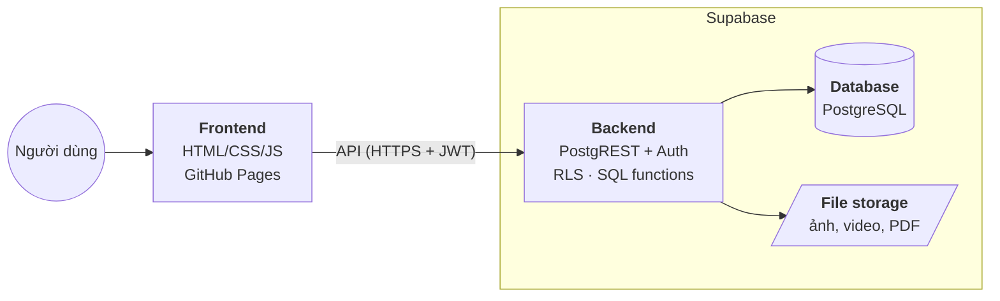

# FactoryKits · Mini-MES ghi nhận downtime

🌐 **https://factorykits.github.io**

Webapp nhỏ để **ghi nhận thời gian dừng máy (downtime)** trong nhà máy, đồng thời là
một repo để **vừa làm vừa học SQL và data model** trên PostgreSQL thật.

- Operator bấm vào máy trên **Board** để báo dừng / báo chạy lại, đồng hồ đếm theo thời gian thực
- Phân loại theo **lý do → nhóm** (planned / unplanned), tự gán **ca làm việc**
- **Đính kèm** ảnh, video, PDF cho từng lần dừng
- **Báo cáo**: tổng downtime, MTTR, downtime theo ngày, **Pareto** lý do
- **Phân quyền**: operator · technician · supervisor · admin

## Kiến trúc



| Tầng | Công nghệ | Nằm ở đâu trong repo |
|---|---|---|
| Frontend | HTML + CSS + JavaScript thuần (không cần build) | [`frontend/`](frontend/) |
| API | Supabase tự sinh REST API từ schema (PostgREST) | (không cần code) |
| Backend: xử lý logic | SQL function, trigger | [`0001`](supabase/migrations/0001_schema.sql), [`0003`](supabase/migrations/0003_logic_and_reports.sql) |
| Backend: kiểm tra quyền | Supabase Auth + Row Level Security | [`0002_security.sql`](supabase/migrations/0002_security.sql) |
| Database | PostgreSQL | [`supabase/migrations/`](supabase/migrations/) |
| File storage | Supabase Storage (bucket `downtime-files`) | [`0004_storage.sql`](supabase/migrations/0004_storage.sql) |
| Hosting | GitHub Pages (deploy bằng GitHub Actions) | [`.github/workflows/`](.github/workflows/deploy-pages.yml) |

**Vì sao dùng Supabase?** GitHub Pages chỉ host được file tĩnh, không chạy được backend hay database.
Supabase cho một PostgreSQL thật kèm Auth, Storage và REST API, có gói miễn phí. Logic backend
được viết **bằng SQL**, nên đây cũng là chỗ học SQL tốt nhất.

## Bắt đầu nhanh

1. Tạo project trên [supabase.com](https://supabase.com) (free)
2. Mở **SQL Editor**, chạy lần lượt các file trong `supabase/migrations/` (0001 → 0005), rồi chạy `supabase/seed.sql`
3. Điền Project URL + anon key vào `frontend/js/config.js` (đã điền sẵn cho project hiện tại)
4. **Settings → Pages → Source: GitHub Actions**, rồi merge vào `main`
5. Mở trang web và **đăng ký tài khoản đầu tiên**: tài khoản này tự động thành **admin**

Hướng dẫn chi tiết, kể cả chạy local và gắn tên miền riêng sau này: **[docs/setup.md](docs/setup.md)**

## Lộ trình học

| # | Tài liệu | Nội dung |
|---|---|---|
| 1 | [docs/data-model.md](docs/data-model.md) | Sơ đồ ERD, vì sao thiết kế như vậy, chuẩn hóa, fact và dimension |
| 2 | [docs/sql-lessons.md](docs/sql-lessons.md) | 20+ bài tập SQL trên chính dữ liệu downtime, có lời giải |
| 0 | [docs/nhat-ky-du-an.md](docs/nhat-ky-du-an.md) | Nhật ký: dự án được xây dựng thế nào, ai làm gì, bài học rút ra |
| 3 | Đọc `supabase/migrations/` | Mỗi file có chú thích "Bài học" ở đầu |
| 4 | Đọc `frontend/js/pages/*.js` | Mỗi trang ghi rõ câu SQL tương ứng với code |

## Cấu trúc thư mục

```
├── frontend/                 # Webapp tĩnh → GitHub Pages
│   ├── index.html
│   ├── css/style.css
│   └── js/
│       ├── config.js         # URL + anon key của Supabase
│       ├── lib.js            # Supabase client + tiện ích
│       ├── app.js            # Đăng nhập + router
│       └── pages/            # board, history, event, reports, admin
├── supabase/
│   ├── migrations/           # Schema, phân quyền, logic, storage
│   └── seed.sql              # Dữ liệu mẫu 30 ngày
├── docs/                     # Hướng dẫn cài đặt + tài liệu học
└── .github/workflows/        # Tự động deploy lên GitHub Pages
```
