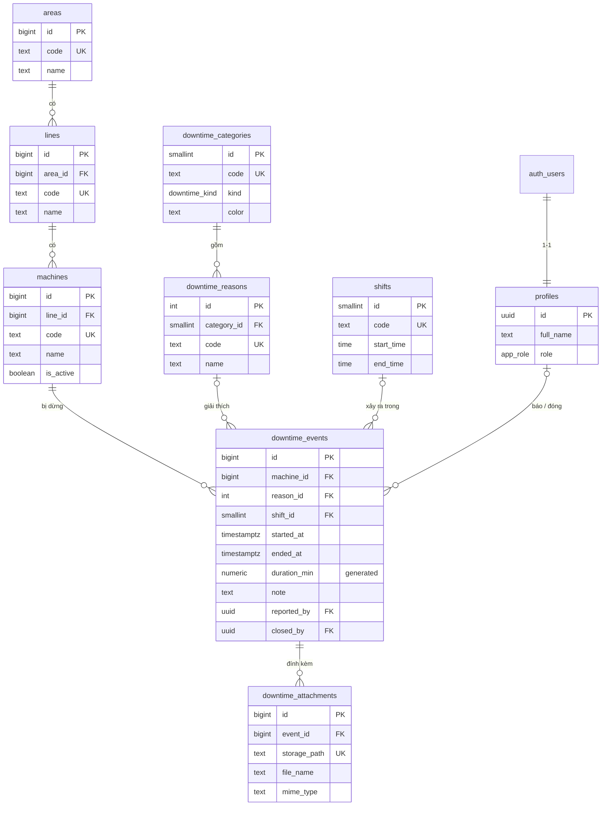

# Data model

## Sơ đồ ERD

## Hai loại bảng

| Loại | Bảng | Đặc điểm |
|---|---|---|
| **Master data** (dimension) | `areas`, `lines`, `machines`, `shifts`, `downtime_categories`, `downtime_reasons`, `profiles` | Ít dòng, ít thay đổi, mô tả "cái gì / ở đâu / ai" |
| **Transaction** (fact) | `downtime_events`, `downtime_attachments` | Nhiều dòng, tăng liên tục, mỗi dòng là một **sự kiện** có thời gian |

Báo cáo luôn có dạng: **lấy fact, JOIN sang dimension để có tên, rồi GROUP BY theo dimension**.
Ví dụ: tổng phút dừng (fact) theo line (dimension).

## Các quyết định thiết kế (và vì sao)

### 1. Lưu `started_at` + `ended_at`, không lưu "số phút" do người dùng gõ
Thời lượng là dữ liệu **suy ra được**, nên để database tự tính (`duration_min` là
*generated column*). Người dùng không thể nhập sai kiểu "bắt đầu 8h, kết thúc 9h, nhưng ghi 90 phút".

### 2. `ended_at IS NULL` nghĩa là "đang dừng"
Không cần thêm cột `status`. Một sự thật chỉ nên lưu **ở một chỗ**. Nếu có cả `status` lẫn
`ended_at` thì sớm muộn hai cột sẽ mâu thuẫn nhau.

### 3. Database tự bảo vệ quy tắc nghiệp vụ
| Quy tắc | Cơ chế |
|---|---|
| Kết thúc phải sau bắt đầu | `CHECK (ended_at > started_at)` |
| Đóng sự kiện phải có lý do | `CHECK (ended_at IS NULL OR reason_id IS NOT NULL)` |
| Một máy không dừng 2 lần trùng giờ | `EXCLUDE USING gist (machine_id WITH =, tstzrange(...) WITH &&)` |
| Mã máy không trùng | `UNIQUE (code)` |
| Lý do phải tồn tại | `FOREIGN KEY` |

Frontend có bug, có người gọi thẳng API, hay sau này viết thêm app mobile: dữ liệu vẫn đúng.

### 4. Lý do 2 cấp: `categories` → `reasons`
Báo cáo cần cả 2 mức: "Cơ khí chiếm 40%" (cấp nhóm) và "Kẹt băng tải chiếm 15%" (cấp lý do).
Đây là **chuẩn hóa** (normalization): tên nhóm chỉ lưu 1 lần trong `downtime_categories`,
không lặp lại trên mỗi lý do.

### 5. `code` + `name` cho mọi master data
`code` (ví dụ `SMT-L1-PNP`) ổn định, ngắn, dùng trong báo cáo và Excel.
`name` thay đổi thoải mái. `id` là khóa kỹ thuật, không cho người dùng thấy.

### 6. Ca được **trigger tự gán**, nhưng vẫn lưu lại
Tính lại ca mỗi lần query cũng được, nhưng nếu sau này đổi giờ ca thì dữ liệu cũ sẽ bị
"nhảy ca". Lưu `shift_id` lúc ghi nhận là chụp lại sự thật **tại thời điểm đó**.

### 7. File nằm ở Storage, database chỉ giữ metadata
Database không phải chỗ để chứa video. Bảng `downtime_attachments` chỉ giữ đường dẫn,
tên, loại và kích thước, còn file thật nằm ở bucket `downtime-files`.

### 8. `timestamptz` cho mọi thời điểm
Luôn lưu thời điểm tuyệt đối (UTC). Chỉ đổi sang giờ Việt Nam khi **hiển thị** hoặc
khi **nhóm theo ngày/ca** (`AT TIME ZONE 'Asia/Ho_Chi_Minh'`).

## Ý tưởng mở rộng (bài tập thiết kế)

Khi đã quen, thử tự thêm vào bằng một migration mới `0005_...sql`:

1. **Sản lượng & OEE**: bảng `production_counts (machine_id, shift_date, shift_id, good_qty, ng_qty)`
   và `machines.ideal_cycle_sec`. Từ đó tính Availability × Performance × Quality.
2. **Lịch sản xuất kế hoạch**: `planned_production_time` theo máy/ngày, để tính tỉ lệ downtime
   trên thời gian kế hoạch thay vì trên 24h.
3. **Work order**: `work_orders` + `downtime_events.work_order_id`, để biết đang chạy model nào khi dừng.
4. **Audit log**: trigger ghi mọi UPDATE/DELETE trên `downtime_events` vào `audit_log (jsonb old, jsonb new)`.
5. **Downtime nhiều cấp**: lý do dạng cây (`parent_id` tự tham chiếu) + recursive CTE.
