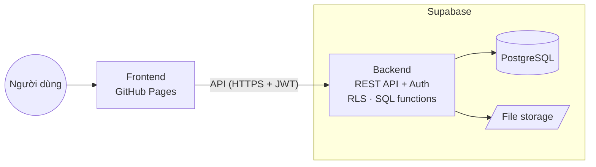

# Nhật ký dự án FactoryKits

Ghi lại toàn bộ quá trình xây dựng webapp, từ repo trống đến khi chạy thật ở
**https://factorykits.github.io**. Thực hiện ngày 16/11/2026, giữa chủ dự án và Claude Code.

## Kết quả

| Thành phần | Ở đâu |
|---|---|
| Webapp | https://factorykits.github.io |
| Code | GitHub repo `factorykits/factorykits.github.io` |
| Database, backend, file storage | Supabase project `factorykits` (region Tokyo `ap-northeast-1`) |

## Kiến trúc đã chọn

| Tầng | Công nghệ | Ghi chú |
|---|---|---|
| Frontend | HTML/CSS/JS thuần, không cần build | Host trên GitHub Pages |
| API | Supabase tự sinh REST API từ các bảng | Không phải viết code |
| Backend | Hàm SQL, trigger, phân quyền RLS | Logic và kiểm tra quyền nằm trong database |
| Database | PostgreSQL 17 trên Supabase | Gói miễn phí |
| File storage | Bucket `downtime-files` | Lưu ảnh, video, PDF |

**Vì sao không chỉ dùng GitHub?** GitHub Pages chỉ host được file tĩnh, không chạy được
backend hay database. Supabase cho một PostgreSQL thật kèm Auth, Storage và REST API miễn phí.
Logic backend viết bằng SQL, nên đây cũng là chỗ học SQL tốt nhất.

## Các giai đoạn

### 1. Viết code (Claude)
- **Database**, 5 file migration trong `supabase/migrations/`:
  - `0001_schema.sql`: 9 bảng (khu vực → line → máy, ca, nhóm → lý do dừng, user, lần dừng,
    file đính kèm). Database tự chặn dữ liệu sai: kết thúc trước khi bắt đầu, một máy dừng
    2 lần trùng giờ, đóng sự kiện mà không có lý do. Trigger tự gán ca và tự cho user đầu tiên
    làm admin.
  - `0002_security.sql`: phân quyền theo 4 vai trò operator → technician → supervisor → admin.
  - `0003_logic_and_reports.sql`: hàm báo dừng / báo chạy lại, các view, báo cáo Pareto,
    báo cáo theo ngày, cập nhật realtime.
  - `0004_storage.sql`: bucket lưu file.
  - `0005_lock_down_functions.sql`: siết quyền gọi hàm theo cảnh báo bảo mật của Supabase.
- **Dữ liệu mẫu** `supabase/seed.sql`: 13 máy, 15 lý do dừng, khoảng 270 lần dừng trong 30 ngày.
- **Frontend**, 5 trang: Board (trạng thái máy, cập nhật realtime), Lịch sử (lọc, xuất CSV),
  Chi tiết (đính kèm file), Báo cáo, Quản trị.
- **Deploy**: workflow GitHub Actions `.github/workflows/deploy-pages.yml`.
- **Tài liệu**: `docs/setup.md`, `docs/data-model.md`, `docs/sql-lessons.md` (21 bài tập SQL).

### 2. Kiểm tra trước khi đưa lên (Claude)
- Chạy toàn bộ SQL trên Postgres 16 local, giả lập phần riêng của Supabase.
- Tìm và sửa lỗi dữ liệu mẫu bị lệch 7 tiếng: `generate_series` trên kiểu `date` trả về
  `timestamptz`, làm `AT TIME ZONE` đổi ngược chiều. Cách sửa: ép kiểu `::timestamp`.
- Thử phân quyền: operator không tự nâng mình lên admin được, không sửa được dữ liệu gốc.
- Render thử các trang trên trình duyệt với dữ liệu giả lập. Sửa lỗi thanh Pareto bị co lại
  và lỗi toast bị lộ ra khi chụp toàn trang.

### 3. Đưa database lên Supabase
- **Chủ dự án:** tạo project Supabase, kết nối connector Supabase với Claude.
- **Claude:** chạy 5 migration và dữ liệu mẫu qua connector; sửa theo cảnh báo bảo mật
  (các hàm `SECURITY DEFINER` không được cho người chưa đăng nhập gọi); thử phân quyền trên
  database thật; điền URL và anon key vào `frontend/js/config.js`. Anon key là khóa công khai,
  dữ liệu được bảo vệ bằng RLS.

### 4. Deploy lên GitHub Pages
- **Claude:** tạo PR và merge vào `main`. Lần deploy đầu thất bại vì Pages chưa được bật.
- **Chủ dự án:** bật Settings → Pages → Source: **GitHub Actions**.
- **Claude:** chạy lại deploy, thành công ở địa chỉ tạm `giacamap.github.io/my-project1`.

### 5. Chuyển sang địa chỉ chuyên nghiệp
- Quyết định: tạo **Organization** `factorykits` thay vì đổi username cá nhân, để có địa chỉ gốc
  `factorykits.github.io` và sau này dễ gắn tên miền `factorykits.app`.
- **Chủ dự án:** tạo Organization, chuyển repo và đổi tên thành `factorykits.github.io`, cài
  GitHub App của Claude cho Organization.
- **Claude:** kết nối repo mới, chạy deploy, cập nhật tài liệu sang địa chỉ mới.

### 6. Chạy thật và sửa lỗi
- Sửa lỗi thanh menu hiện ra khi chưa đăng nhập: CSS `display: flex` đè lên thuộc tính
  `hidden`. Cách sửa: thêm `[hidden] { display: none !important; }`.
- Link xác nhận email dẫn về `localhost:3000`. Tra database thì thấy email thật ra đã được
  xác nhận; nguyên nhân là **Site URL** của Supabase còn để mặc định. Cách sửa: đặt Site URL
  thành `https://factorykits.github.io` và thêm Redirect URL `https://factorykits.github.io/**`.
- Xóa tài khoản test. Lần dừng máy đã ghi vẫn giữ lại, chỉ bỏ trống người báo và người đóng.
- Chủ dự án test toàn bộ, app chạy ổn.

## Ai làm gì

| Việc | Ai làm | Vì sao |
|---|---|---|
| Viết code, SQL, tài liệu, kiểm thử | Claude | |
| Chạy SQL lên Supabase | Claude | Qua connector Supabase |
| Tạo PR, merge, chạy deploy | Claude | Qua GitHub App của Claude |
| Tạo tài khoản, project, Organization | Chủ dự án | Cần đăng nhập tài khoản cá nhân |
| Bật Pages, chuyển và đổi tên repo, cài GitHub App | Chủ dự án | Công cụ của Claude không vào được Settings |
| Cài đặt đăng nhập trên Supabase (Site URL) | Chủ dự án | Connector không chỉnh được phần Auth |

## Bài học rút ra
1. **Chọn region một lần.** Supabase không cho đổi region sau khi tạo project.
2. **Lưu thời điểm bằng `timestamptz`** và chỉ đổi múi giờ khi hiển thị hoặc nhóm theo ngày.
   Cẩn thận chiều của `AT TIME ZONE`.
3. **Để database tự bảo vệ dữ liệu** bằng `CHECK`, `EXCLUDE`, `FOREIGN KEY`, RLS, thay vì tin
   vào frontend.
4. **Chạy Security Advisor của Supabase** sau mỗi lần đổi schema.
5. **Đặt Site URL trên Supabase trước khi cho người dùng đăng ký.**
6. **Repo `<org>.github.io`** cho địa chỉ gốc, không có đường dẫn con phía sau.

## Việc còn lại
1. Đăng ký lại tài khoản admin trước khi mời người khác (người đăng ký đầu tiên là admin).
2. Khi mua `factorykits.app`: làm theo [setup.md](setup.md) mục 4.
3. Học tiếp: [data-model.md](data-model.md) → [sql-lessons.md](sql-lessons.md) → tự viết
   migration `0006` cho sản lượng và OEE.
